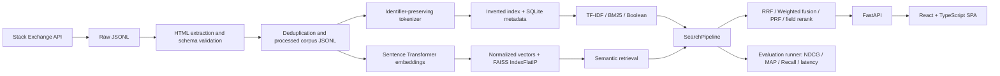

# CodeFinder Architecture

## Purpose and scope

CodeFinder is a local, unauthenticated developer-error search engine. It indexes real Stack Overflow question/answer pairs collected through the documented Stack Exchange API. Each processed record retains its canonical question URL and license label. The implementation does not create accounts or require ownership checks.

## Pipeline

## Modules

- `backend/app/crawler`: API collection and Stack Exchange HTML-to-text extraction.
- `backend/app/models`: shared document schema and API response models.
- `backend/app/indexing`: normalization, tokenization, inverted and metadata indexes.
- `backend/app/retrieval`: TF-IDF, BM25, Boolean and FAISS-backed semantic search.
- `backend/app/ranking`: rank fusion, explainable score blending, and field-aware reranking.
- `backend/app/services/search_pipeline.py`: consistent cross-mode orchestration and PRF.
- `backend/app/api`: FastAPI routes.
- `backend/app/evaluation`: query/qrel preparation, metrics and graph algorithms.
- `frontend/src`: React SPA and typed API client.

## Storage

- `data/raw/stackexchange_raw.jsonl`: raw question API items.
- `data/raw/stackexchange_answers.jsonl`: raw answer API items.
- `data/processed/corpus.jsonl`: normalized searchable documents.
- `data/processed/stats.json`: actual corpus counts after validation/deduplication.
- `indexes/inverted_index.pkl`, `doc_lengths.pkl`: postings and lengths. Pickle files must only be loaded from trusted local builds.
- `indexes/meta_index.json`: document payloads and metadata indexes.
- `indexes/metadata.db`: SQLite document metadata.
- `embeddings/faiss.index`, `doc_ids.json`, `doc_embeddings.npy`: FAISS vectors and explicit row-to-document mapping.
- `data/evaluation/`: generated queries, qrels, saved metrics and run artifacts.

## Retrieval flow

Each lexical or semantic retriever yields document IDs, scores, matched/source evidence and snippets. For hybrid modes, the pipeline retrieves up to `max(5 * top_k, 50)` candidates from both searchers. RRF uses one-based ranks and configured constant `RRF_K`; weighted fusion min-max-normalizes scores independently. PRF derives expansion terms from the top three lexical results and runs a second BM25 pass. The transparent re-ranker blends normalized base score with title/error-message overlap. All exposed result explanations identify the retrieval method and score components.

PageRank and HITS are computed over a deterministic document graph based on shared metadata and diagnostic terms. Graph scores are stored for analysis but intentionally are not silently applied to default ranking; the report describes graph-aware ranking as an optional future experiment.

## Runtime and performance

The backend loads local indexes at application startup. Lexical search has no model inference. Semantic queries load the selected `sentence-transformers/all-MiniLM-L6-v2` bi-encoder once at startup and encode one query per request. CPU embedding throughput and API timings are measured by the evaluation runner; see `data/evaluation/results/summary.md` after running it. There is no performance claim until that experiment completes.

## Trust and safety

- HTML is converted to plain text before rendering; result highlighting escapes content before inserting `<mark>` tags.
- The frontend uses source text through React text nodes for details/code.
- Pickle artifacts are local generated artifacts and are not loaded from arbitrary user uploads.
- CORS is limited to local Vite development/preview origins.
- There is no authentication or ownership validation, by design.
